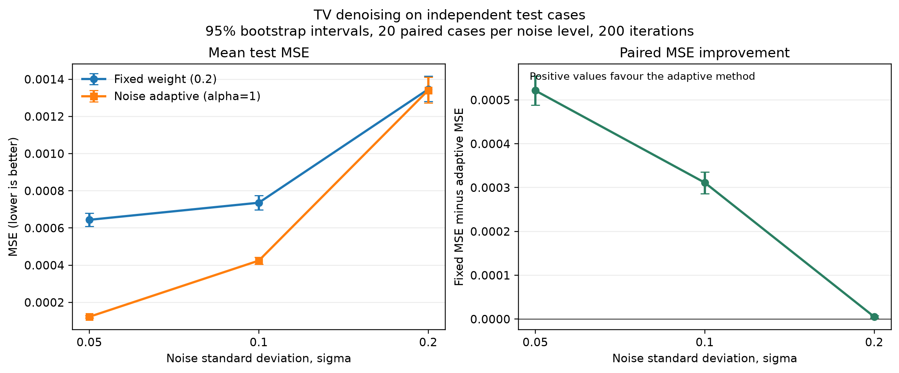
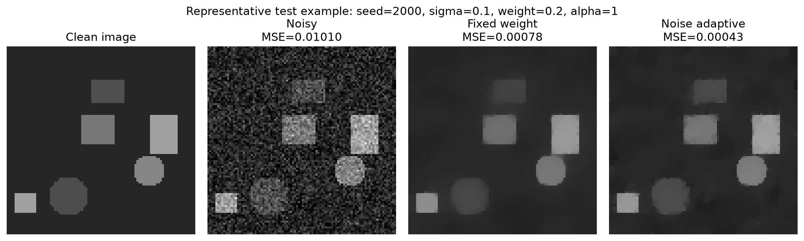

# Total Variation (TV) Image Denoising
EEP55C36 Computational Methods and Algorithms  

**Maël BONNEC (19336560)** – *November 2026*


## 1. Problem and Paper

This report examines how Gaussian noise can be removed from greyscale images while retaining important edges. The clean image is denoted by $u_0$, the observed image by $f$, and the noise by $\omega$. The observation model is $f=u_0+\omega$. Noise samples are assumed to be independent, have zero mean, and have standard deviation $\sigma$.

The implementation follows the two-dimensional denoising method in Chambolle's paper [1] and the image task described in the assignment handout [2]. A fixed-weight total variation (TV) method is compared with a noise-adaptive modification.


## 2. Mathematic and Implementation

To recover image $u$ from the observation $f$, the Rudin-Osher-Fatemi objective is minimised

$$
F(u)=\frac{1}{2}\|u-f\|_2^2+\lambda\,TV(u),\qquad
TV(u)=\sum_{i,j}\sqrt{(D_r u_{i,j})^2+(D_c u_{i,j})^2}.
$$

The parameter $\lambda$ sets the balance between matching the observation and smoothing. The data term penalises differences between $u$ and $f$. The operators $D_r$ and $D_c$ measure forward brightness changes to the next row and column. At each pixel, isotropic TV combines these changes by their Euclidean length, then sums the lengths over the image.

Chambolle's dual method uses an auxiliary vector field $p^k$ with two components at each pixel. It is initialised at $p^0=0$. At iteration $k$, the gradient $g^k=\nabla(\operatorname{div}p^k-f/\lambda)$ is calculated, and the field is updated as follows

$$
p^{k+1}_{i,j}=\frac{p^k_{i,j}+\tau g^k_{i,j}}{1+\tau\|g^k_{i,j}\|_2},
\qquad u=f-\lambda\operatorname{div}p.
$$

The gradient $\nabla$ returns the row and column differences, while $\operatorname{div}$ combines the two field components into an image. The implementation uses $\tau=1/8$ and 200 iterations. Forward differences are zero at the bottom row and right column, and the divergence follows the matching negative-adjoint rule [2]. For an image of height $H$ and width $W$, each iteration takes $\mathcal{O}(HW)$ time and the working arrays use $\mathcal{O}(HW)$ memory. 


## 3. The Change

The modified method estimates the noise level from neighbouring horizontal pixel pairs. Each difference is divided by $\sqrt{2}$. The median absolute deviation (MAD) is then divided by $0.67449$ to estimate the Gaussian noise standard deviation $\hat{\sigma}$ [2]. The TV weight is set to

$$
\lambda_{\mathrm{adaptive}}=\max(\alpha\hat{\sigma},10^{-8}).
$$

$\alpha$ determines how strongly the estimated noise affects smoothing. Parameter selection was carried out on validation images using mean squared error (MSE), with equal weighting across noise levels. Fixed weights of $0.05$, $0.10$, and $0.20$ were tested, with $\alpha$ values of $0.5$, $1.0$, and $1.5$. The selected values were $\lambda=0.20$ and $\alpha=1.0$.

Chambolle also describes choosing the TV weight so that the residual matches the expected noise level [1]. The TV weight is adjusted according to the estimated noise level. The scaling factor is chosen by testing different values on the validation images and selecting the one with the lowest average MSE. It uses the noise estimate but it does not implement the paper's residual-matching rule.

\newpage


## 4. Experiments

The handout generator produces $96\times96$ images which contains four rectangles and two disks [2]. Independent Gaussian noise is added without clipping. Testing covers noise standard deviations $\sigma=0.05$, $0.10$, and $0.20$, with 20 seeds at each level. Development seeds range from 0 to 19, validation seeds from 1000 to 1019, and test seeds from 2000 to 2019. The test images were not used to select the parameters.

For each test case, both methods use the same noisy image, boundary conditions and 200 iterations. The baseline method uses a fixed TV weight of 0.20, while the adaptive method uses a scaling factor of $\alpha=1.0$. The main evaluation metric is mean squared error (MSE), where the lower values indicate better results. Peak signal-to-noise ratio (PSNR) is also measured in decibels (dB), where higher values indicate better results. The improvement is calculated by comparing the results of both methods for the same random seed. The 95% confidence intervals are estimated by resampling the 20 paired test cases 5,000 times at each noise level.


## 5. Results and Interpretation

| Noise $\sigma$ | Fixed MSE | Adaptive MSE | MSE gain [95% CI] | PSNR gain (dB) [95% CI] |
|---:|---:|---:|:---|:---|
| 0.05 | 0.000644 | 0.000123 | 0.000521 [0.000488, 0.000554] | 7.19 [6.98, 7.38] |
| 0.10 | 0.000736 | 0.000425 | 0.000311 [0.000287, 0.000335] | 2.38 [2.26, 2.50] |
| 0.20 | 0.001346 | 0.001341 | 0.000005 [0.000003, 0.000007] | 0.02 [0.01, 0.02] |

Positive gains mean that the adaptive method performs better than the baseline. At $\sigma=0.05$ and $0.10$, the adaptive method achieved lower MSE and higher PSNR. At $\sigma=0.20$, they produced similar results because the adaptive TV weight was close to the fixed weight. Although the confidence intervals were above zero, the improvement was too small to make a noticeable difference in practice.

{width=100%}

{width=100%}

The normal example uses test seed 2000 and $\sigma=0.10$.

A separate test was run on images which contains a checkerboard pattern using 20 new random seeds. Within the textured region, the mean MSE was 0.0253 for the baseline and 0.0201 for the adaptive method. The baseline kept 18% of the original texture contrast, while the adaptive method preserved 31%. Although the adaptive method preserved more texture, both methods removed a large amount of the original detail. This shows one of the limitations of TV denoising, as it can smooth out actual image details as well as noise.

These results are limited to the synthetic images and Gaussian noise used in the experiments. The presence of edges and texture may affect the accuracy of the noise estimation. Neither method was tested on natural photographs. The average median runtimes for the fixed and adaptive methods were 19.3 ms and 19.1 ms at $\sigma=0.05$, 18.7 ms and 18.8 ms at $\sigma=0.10$, and 18.7 ms and 18.8 ms at $\sigma=0.20$, respectively. The runtimes were similar for both methods, which means that the additional noise estimation step had small impact on the execution time. Each test case included one warm-up run followed by three timed runs. All measurements were carried out on a MacBook Pro with an Apple M1 Pro chip, running macOS 27.2.1, Python 3.12.16, NumPy 2.5.4 and Matplotlib 3.11.2.


## 6. Reproduction

To reproduce the results, install the pinned Python packages and run these commands from the repository folder:

```bash
python -m pip install -r requirements.txt
python -m unittest discover -s tests -v
python run_experiments.py --tune-validation
python run_experiments.py --split test --config outputs/selected_parameters.json
python run_texture_stress.py
python plot_results.py
```

The scripts save the selected settings, paired results, summary table, overall comparison, and image examples in `outputs/`. The repository is [github.com/SatelliteHub/total_variation_denoising](https://github.com/SatelliteHub/total_variation_denoising). 

**AI use:** OpenAI Codex was used for selected support tasks, including explaining the TV denoising theory, providing guidance on code implementation, preparing a test script and helping debug errors. AI support was also used to format the final code and report, and to check spelling and grammar. The project author developed and implemented the code, conducted the experiments and interpreted the results.

\newpage

## References

[1] A. Chambolle, “An Algorithm for Total Variation Minimization and Applications,” *Journal of Mathematical Imaging and Vision*, vol. 20, pp. 89–97, 2004. https://doi.org/10.1023/B:JMIV.0000011325.36760.1e

[2] EEP55C36 Computational Methods and Algorithms, *Final-project mathematical guide: Image processing: total-variation denoising*, assignment handout, Trinity College Dublin, 2026.
